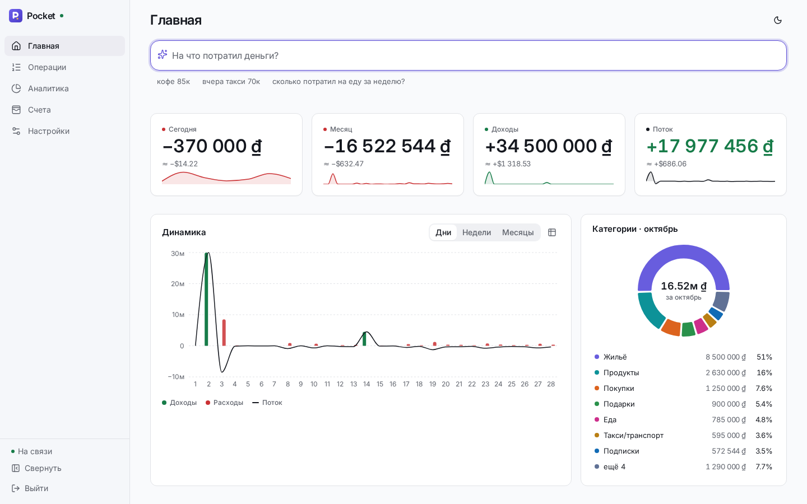
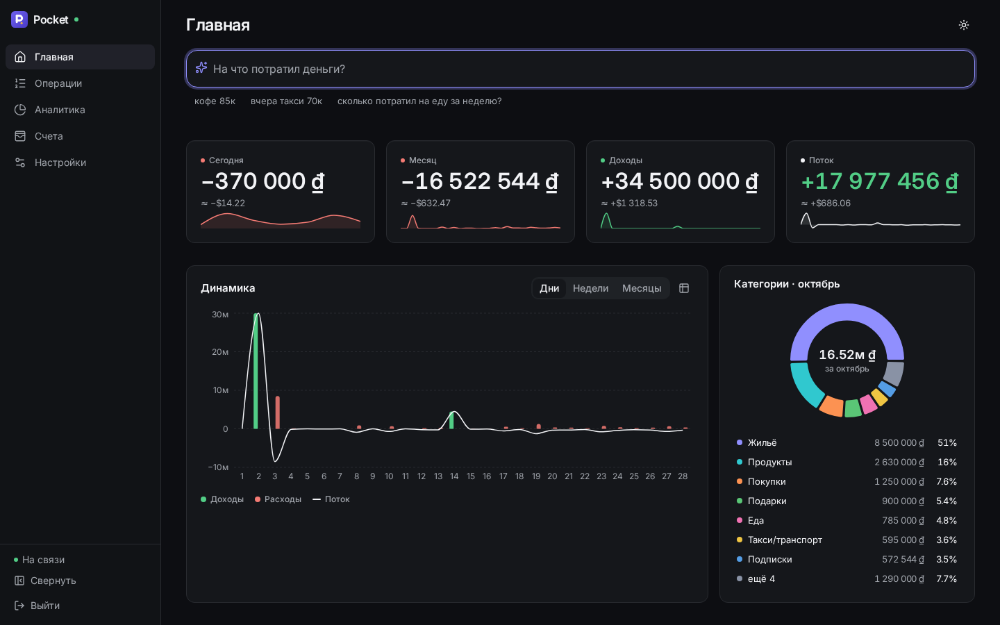
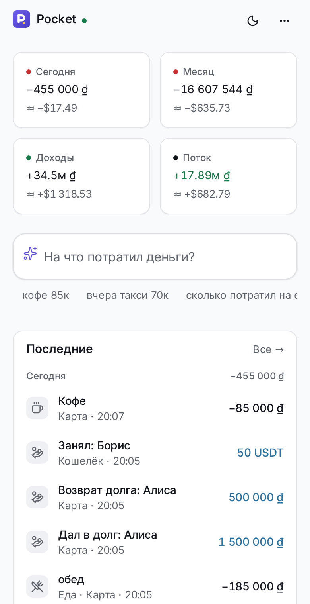
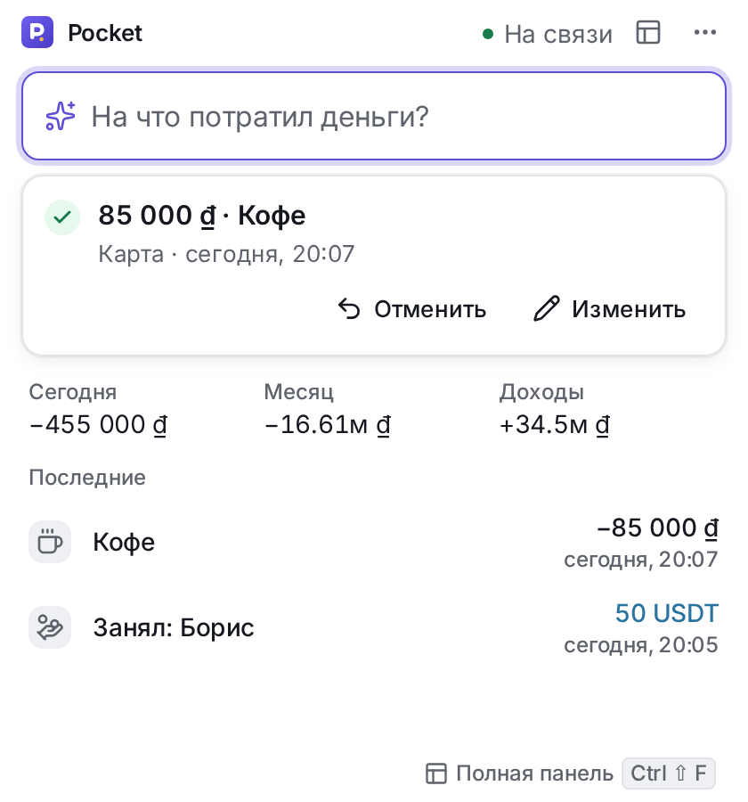
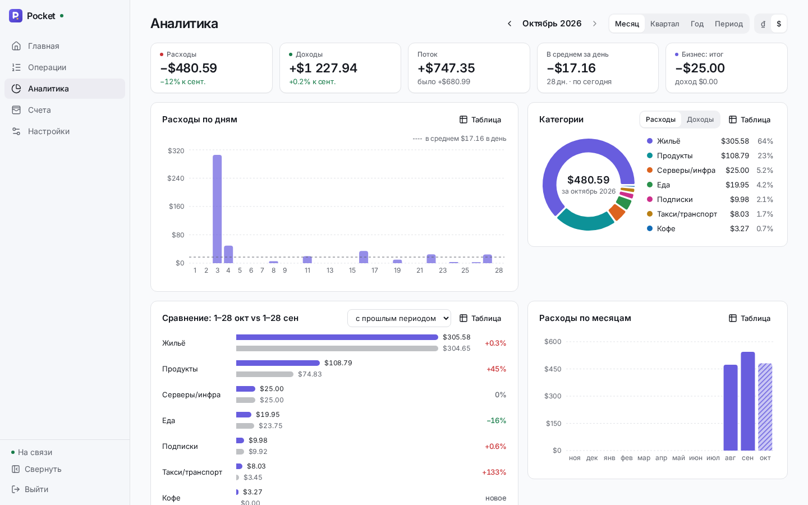
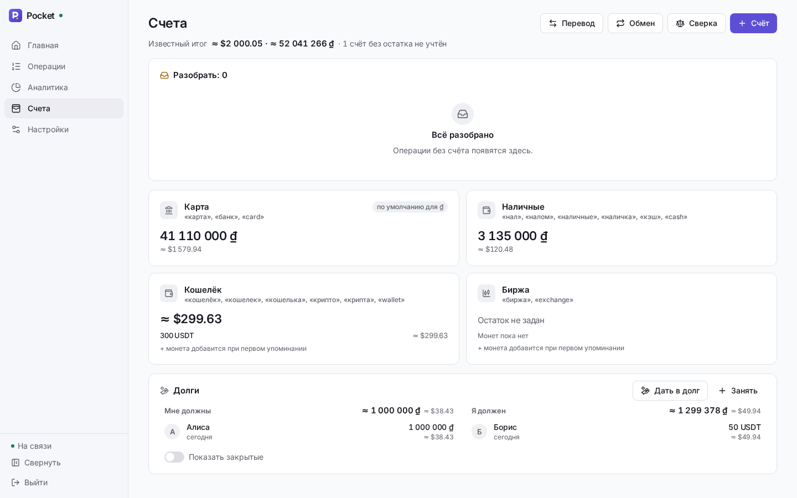

# Pocket Finance

Личный учёт финансов, который понимает обычный текст. Пишете «кофе 85к», «такси 120к налом»
или «перевёл 50 usdt с кошелька на биржу» — встроенный парсер (а для сложных фраз — LLM)
превращает это в операцию, кладёт в нужную категорию и пересчитывает остатки. Одна база и один
backend для веба/PWA, Telegram-бота и приложения быстрого ввода для Windows и macOS.

Self-hosted, лицензия [MIT](LICENSE). Интерфейс и бот — на русском. **English:** [README.md](README.md).



| Тёмная тема | Телефон (PWA) | Quick Capture (Electron) |
|---|---|---|
|  |  |  |

| Аналитика | Счета и долги |
|---|---|
|  |  |

## Возможности

- **Ввод текстом** в вебе, в Telegram и в мини-окне у трея Windows / строки меню macOS (`Ctrl+Alt+Space` / `⌘⇧Space`): несколько
  операций в одном сообщении, даты («вчера», «в пятницу»), счета («налом», «с карты»), получатели
  (`@ник`), правки («нет, 250к»), отмена («отмени»), вопросы («сколько на еду в октябре?»).
- **Мультивалютность и крипта**: ₫, $, ₽, USDT, TON, BTC… Мультивалютные кошельки, обмены,
  переводы между счетами, курсы (Vietcombank, ЦБ РФ, CoinGecko; запасной для фиата — open.er-api.com) на дату операции.
- **Долги**: кому дал, у кого занял, частичные возвраты, прощение, напоминания в Telegram.
- **Регулярные платежи** и напоминания, месячные и ежедневные отчёты в Telegram.
- **Аналитика**: расходы/доходы/поток, категории, динамика, сравнение периодов, бизнес-расходы.
- **Всё обратимо**: у каждого действия «Отменить», история изменений, превью перед массовыми правками.
- **Экспорт** CSV/XLSX и полный JSON, удаление всех данных.
- **Вход**: пароль, passkeys / Face ID (WebAuthn), токены устройств для Electron.
- **AI необязателен**: с `AI_ENABLED=false` работает только встроенный правиловый парсер.

## Архитектура

```
 браузер / PWA / Electron / Telegram-бот
        │ HTTPS
 [ваш reverse-proxy  ИЛИ  встроенный Caddy (профиль standalone, Let's Encrypt)]
        │
      web (Caddy): статика SPA + /api/* ─────► api (FastAPI, миграции при старте)
                                               worker (курсы, отчёты, напоминания)
      bot (aiogram, long polling) ── HTTP ─────┘        │
      backup (pg_dump по расписанию, ротация, rsync) ── db (PostgreSQL 16, внутренняя сеть)
```

| Каталог | Что это |
|---|---|
| `backend/` | FastAPI + SQLAlchemy 2 + Alembic, Python 3.12 (`uv`); процессы `api` и `worker` |
| `bot/` | Telegram-бот на aiogram 3, ходит в API по HTTP |
| `web/` | React + Vite, PWA (ставится на iPhone), режим Quick Capture для Electron |
| `desktop/` | Electron для Windows и macOS: трей / строка меню, глобальный хоткей, мини-окно |
| `infra/`, `scripts/` | Dockerfile'ы, Caddy, бэкапы, обновление, проверка стека |
| `docs/` | установка, архитектура, API, дизайн, бэкапы, обновление |

Деньги — только `Decimal` / `NUMERIC`, никакого float. Подробно — [`docs/ARCH.md`](docs/ARCH.md),
контракт REST — [`docs/API.md`](docs/API.md).

## Быстрый старт (Docker Compose)

Нужны Linux-сервер с Docker Engine 25+ и `docker compose` v2.24+, домен с HTTPS.

```bash
git clone https://github.com/d3grando/pocket-finance.git /opt/pocket && cd /opt/pocket
scripts/gen-secrets.sh          # создаст .env (права 600) и сгенерирует SECRET_KEY, BOT_SERVICE_TOKEN, пароль БД
nano .env                       # PUBLIC_URL, AI_*, при желании TELEGRAM_* (см. таблицу ниже)

docker compose up -d --build                          # за своим reverse-proxy (порт 8080)
# или на голом VPS: PF_DOMAIN=… в .env, затем
docker compose --profile standalone up -d --build     # Caddy сам получит сертификат

docker compose exec api pf-entrypoint cli create-owner   # пользователь + пароль (печатается один раз)
curl -s http://127.0.0.1:8080/api/v1/health              # {"status":"ok","db":true,...}
```

Откройте сайт по адресу из `PUBLIC_URL`, войдите, задайте начальные остатки. Для пробы без домена
(через SSH-туннель или прямо на `http://127.0.0.1:8080`) оставьте в `PUBLIC_URL` адрес `https://`
(с `http://` API не запустится; подойдёт любая заглушка) и добавьте адрес, который открываете,
в `WEB_ORIGINS`:

```bash
PUBLIC_URL=https://pocket.example.com
WEB_ORIGINS=http://127.0.0.1:8080
```

Без `WEB_ORIGINS` вход пройдёт, а любые изменения будут отклонены проверкой CSRF (origin не
совпадает с `PUBLIC_URL`). По голому `http://` работают только `127.0.0.1` / `localhost`: кука сессии
помечена `Secure`, и браузеры принимают такие куки по http только на этих адресах. С другой машины —
через SSH-туннель (`ssh -L 8080:127.0.0.1:8080 ваш-сервер`, затем `http://127.0.0.1:8080`); на любом
другом http-адресе (IP в локальной сети, IP сервера) вход молча не пройдёт — там нужен HTTPS (профиль
`standalone` с доменом или свой reverse-proxy). Если контейнер `caddy` в профиле standalone постоянно перезапускается —
смотрите `docker compose logs caddy` (обычно не задан `PF_DOMAIN`). Подробно (reverse-proxy, IP клиентов, PWA,
Face ID) — [`docs/INSTALL.md`](docs/INSTALL.md); обновление — [`docs/UPDATE.md`](docs/UPDATE.md);
бэкапы — [`docs/BACKUP.md`](docs/BACKUP.md).

### Главные переменные `.env`

| Переменная | Нужна | Что это |
|---|---|---|
| `PUBLIC_URL` | всегда | публичный https-адрес сайта, например `https://pocket.example.com` |
| `AI_BASE_URL`, `AI_API_KEY`, `AI_MODEL` | если `AI_ENABLED=true` | любой OpenAI-совместимый API |
| `AI_ENABLED` | — | `false` — работать без LLM, только правиловый парсер |
| `TELEGRAM_BOT_TOKEN` | для бота | токен от @BotFather |
| `TELEGRAM_ALLOWED_IDS` | для бота | ваш Telegram id (узнать у @userinfobot); пусто — бот не отвечает никому |
| `TELEGRAM_BOT_USERNAME` | для бота | имя бота без `@`, чтобы веб показывал ссылку на него |
| `TRUSTED_PROXIES` | за reverse-proxy | точный адрес прокси, чтобы лимиты входа видели настоящий IP клиента |
| `DEFAULT_TIMEZONE` | — | пояс по умолчанию, `Asia/Ho_Chi_Minh` |

Все переменные с комментариями — в [`.env.example`](.env.example), полная таблица — `docs/INSTALL.md` §8.

> **Умолчания продукта.** Pocket вырос из учёта во Вьетнаме: основная валюта по умолчанию — ₫,
> пояс — `Asia/Ho_Chi_Minh`, в словаре продавцов есть местные сети. Пояс сервера меняется через
> `DEFAULT_TIMEZONE`, а у каждого пользователя валюта ввода, валюта аналитики и пояс — в
> «Настройки → Общие». Стартовые счета нейтральные («Карта», «Наличные», «Кошелёк», «Биржа») —
> переименуйте их или добавьте свои, псевдонимы («налом», «с карты») задаются там же.

### AI-провайдер

Подойдёт любой OpenAI-совместимый endpoint: OpenAI (`https://api.openai.com/v1`), OpenRouter,
локальные Ollama (`http://host:11434/v1`) или vLLM. Учтите: в LLM уходит текст фраз, которые
не разобрал встроенный парсер, и краткий контекст (названия счетов, категорий, продавцов, людей
в долгах — без сумм). Выбирайте провайдера, которому доверяете. Какую модель взять — прогоните
бенчмарк на своих кандидатах: [`docs/BENCH.md`](docs/BENCH.md).

### Telegram-бот

1. @BotFather → `/newbot` → токен в `TELEGRAM_BOT_TOKEN`, имя — в `TELEGRAM_BOT_USERNAME`.
2. Свой id → `TELEGRAM_ALLOWED_IDS`, затем `docker compose up -d bot` и `/start` боту.

Бот работает через long polling (входящие порты не нужны). Без токена контейнер `bot` просто ждёт.

### Приложение для Windows и macOS

Мини-окно у трея (на Mac — в строке меню) с глобальным хоткеем для быстрого ввода: `Ctrl+Alt+Space`
на Windows, `⌘⇧Space` на macOS. Готовые сборки — в каждом
[релизе](https://github.com/d3grando/pocket-finance/releases): `Pocket-Setup-*.exe` (Windows x64) и
`Pocket-*-mac-arm64.dmg` (Apple Silicon), рядом SHA256. При первом запуске приложение спросит адрес
вашего сервера.

Сборки не подписаны платным сертификатом. Windows SmartScreen: «Подробнее → Выполнить в любом
случае». macOS: один раз «Системные настройки → Конфиденциальность и безопасность → Всё равно
открыть» или `xattr -dr com.apple.quarantine /Applications/Pocket.app`.

Собрать самому — `desktop/` (см. [`desktop/README.md`](desktop/README.md) и `docs/INSTALL.md` §7);
адрес сервера можно вшить при сборке (`PF_DEFAULT_SERVER_URL`).

## Безопасность

Пароли — argon2, cookie-сессии с CSRF, токены устройств и passkeys, лимиты попыток входа,
строгий CSP, изолированный рендерер Electron, база во внутренней сети без выхода наружу.
Модель угроз, известные ограничения и как сообщить об уязвимости — [`SECURITY.md`](SECURITY.md).

## Разработка

```bash
cd backend && uv sync && uv run ruff check . && uv run pytest   # нужен PostgreSQL 16 (TEST_DATABASE_URL)
cd bot && uv sync && uv run pytest
cd web && pnpm install && pnpm lint && pnpm test && pnpm build  # e2e: pnpm e2e
cd desktop && pnpm install && pnpm test && pnpm build
scripts/test-stack.sh                                           # весь стек в Docker
```

Тесты не ходят в сеть: LLM подменяется локальным фейковым сервером, Telegram — моками.
Как прислать изменения — [`CONTRIBUTING.md`](CONTRIBUTING.md). CI — GitHub Actions
(`.github/workflows/ci.yml`).

## Лицензия

[MIT](LICENSE) © 2026 d3grando
